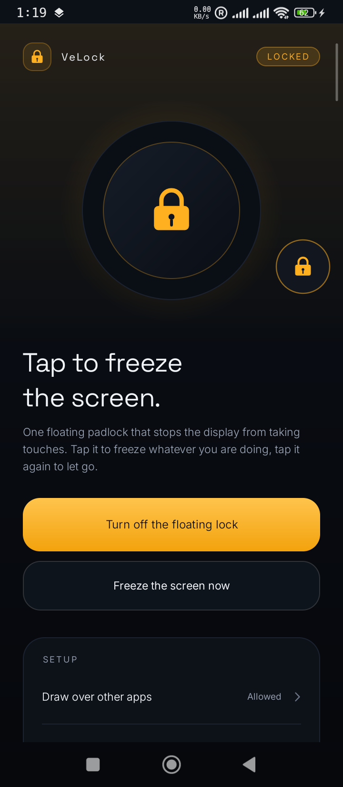
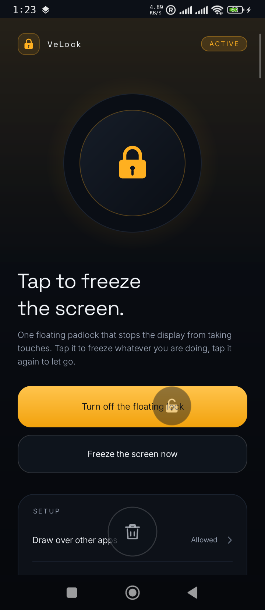

# VeLock — Display Lock

A floating padlock that freezes the screen.

Tap it and the display stops taking touches — the app underneath keeps showing,
but nothing responds. Tap the padlock again and the phone is yours again.

No root. No accessibility service. No dependencies. Under 600 KB, typefaces included.



## What it is for

Any screen you want to keep exactly as it is while your hands are busy — or while
somebody else is holding the phone.

- **Watching a video.** Freeze the screen while it plays and a stray palm, a thumb
  on the bezel or a kid grabbing the phone can no longer pause it, scrub it or
  jump to another app mid-scene.
- **Handing the phone to a child.** The video, the game, the story they are
  looking at stays exactly where it is. Poking, swiping and dragging do nothing
  until you take the phone back, wake the padlock and release it with one tap.
- **Following a recipe, a map or a manual with wet or dirty hands.** Set the page,
  freeze it, and brushes against the screen stop scrolling you away from the step
  you are on. The screen still dims and sleeps on its usual timer, so this costs
  nothing extra.
- **Passing the phone around.** Photos, a boarding pass, a receipt — freeze it and
  nobody accidentally likes, sends, buys or closes anything while the phone
  changes hands.
- **Cleaning the screen or carrying the phone in hand.** Wipe it, pocket it, hold
  it against something: the display keeps showing what it showed.

The lock is always yours: it takes one tap to undo, and the Quick Settings tile
and the status notification can stop it from anywhere.

## How it works

1. **Add the tile.** Pull the shade down, tap the pencil, drag **Display Lock**
   into your Quick Settings tiles.
2. **Tap the tile.** A small padlock floats above whatever you are doing.
   Drag it wherever you like — the position is remembered.
3. **Tap the padlock.** The screen freezes. The padlock stays visible for three
   seconds, then fades out completely so the screen looks untouched.
4. **Tap anywhere on the frozen screen.** The padlock wakes up at full strength and
   stays visible until you use it. Tap it to release the screen. While it is
   invisible, a tap or a swipe across it only wakes it — it never unlocks, and it
   can never be dragged away, because acting on something you cannot see is
   exactly what the lock exists to prevent.
5. **Drop it on the bin to get rid of it.** Drag the padlock and a bin appears at
   the bottom of the screen. Release over the bin and the lock is removed.

| Frozen | Dragging to remove |
| --- | --- |
|  |  |

## Install on your phone (no computer needed)

1. Open the latest release **on your phone**:
   <https://github.com/veloredge/velock/releases/latest>
2. Download `VeLock-1.0.0.apk`.
3. Tap the downloaded file. If Android asks, allow **Install unknown apps** for
   your browser once, then tap **Install**.
4. Open **VeLock** and allow **Draw over other apps** — the button takes you
   straight to the right settings screen.
5. Pull the shade down, tap the pencil, and drag **Display Lock** into your tiles.

Requires Android 9 (API 28) or newer. The APK is signed with the project's release
key, so updates install straight over the previous version.

## Build from source

```bash
git clone https://github.com/veloredge/velock.git
cd velock
./gradlew :app:assembleDebug
adb install -r app/build/outputs/apk/debug/app-debug.apk
```

To produce a signed release APK, create `keystore.properties` in the project root
(it is gitignored and never committed):

```properties
storeFile=release/velock-release.jks
storePassword=…
keyAlias=velock
keyPassword=…
```

then run `./gradlew :app:assembleRelease`.

## What "frozen" actually means

Android does not let an ordinary app block the whole device, and VeLock does not
pretend otherwise. It puts a transparent full-screen layer above everything that
consumes every touch before any app can act on it. Practically, the screen stops
responding.

Still reachable while frozen, because the system owns them:

- the notification shade and the Quick Settings tile, which is your escape hatch
- the power and volume hardware keys
- system gesture navigation (back / home swipes)

Everything inside applications is blocked, including the app that had focus.

## Battery

The app is deliberately quiet, because a background overlay that leaks is worse
than no overlay at all:

- no wake lock, no `KEEP_SCREEN_ON`, no reason for the screen to stay awake
- no polling, no repeating timers, no sensor listeners, no analytics
- one 64 dp window while idle; the full-screen layer exists only while frozen
- screen metrics are measured once per configuration change, never per touch move
- animators are one-shot and end, the padlock is drawn with plain Canvas calls
- the status notification is `IMPORTANCE_LOW`: silent, no badge, no heads-up
- nothing leaves the device — the app has no `INTERNET` permission

## Permissions

| Permission | Why |
| --- | --- |
| `SYSTEM_ALERT_WINDOW` | draw the padlock and the touch layer over other apps |
| `FOREGROUND_SERVICE` + `FOREGROUND_SERVICE_SPECIAL_USE` | keep the overlay alive while it is on screen |
| `POST_NOTIFICATIONS` (optional) | show the quiet status notification with a "Turn off" action |

No internet. No contacts, storage, camera, location or accessibility access.

## Build

```bash
./gradlew :app:assembleDebug
```

- JDK 17 or newer
- Gradle 9.3.1 (wrapper) and Android Gradle Plugin 8.13.1
- `compileSdk 34`, `minSdk 28` (Android 9), `targetSdk 34`
- framework APIs only — no AndroidX, no third-party libraries
- bundled typefaces: Inter and Space Grotesk, see
  [THIRD-PARTY-NOTICES.md](THIRD-PARTY-NOTICES.md)
- `./gradlew :app:lintDebug` is clean; the only two remaining notices are the
  deliberate choice not to chase API 35/36 (documented in `app/build.gradle.kts`)

## Project layout

```
app/src/main/java/com/veloredge/velock/
  MainActivity.java        onboarding, permissions, manual freeze
  LockTileService.java     Quick Settings tile
  LockOverlayService.java  owns the windows; fully event driven
  BubbleView.java          the padlock: drawn, draggable, low opacity
  ShieldView.java          invisible full-screen touch sink
  TrashView.java           drop-to-remove target, only alive during a drag
  LockState.java           in-process state shared by tile, service, activity
  Store.java               window position
```

A few notes for readers of the source:

- The shield is added first and the padlock is re-added after it so the padlock
  always sits above the touch layer. That re-attach can happen in the middle of a
  touch stream, so `BubbleView` refuses to drag without a `DOWN` in the current
  attachment (`onDetachedFromWindow` clears the flag) — without that guard a stale
  stream drags the padlock by itself.
- Nothing is delivered through broadcasts. The service, the tile and the activity
  share one process, so state changes go through `LockState` and a weak observer.
- If the padlock cannot be re-attached above the shield, the freeze is rolled back
  and the screen is released: a frozen screen with no way out is the one failure
  mode this app must never have.

## License

[MIT](LICENSE). Bundled fonts are under the SIL Open Font License 1.1.
